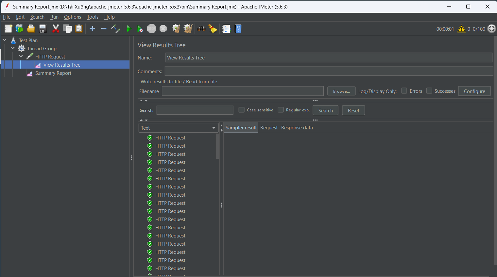
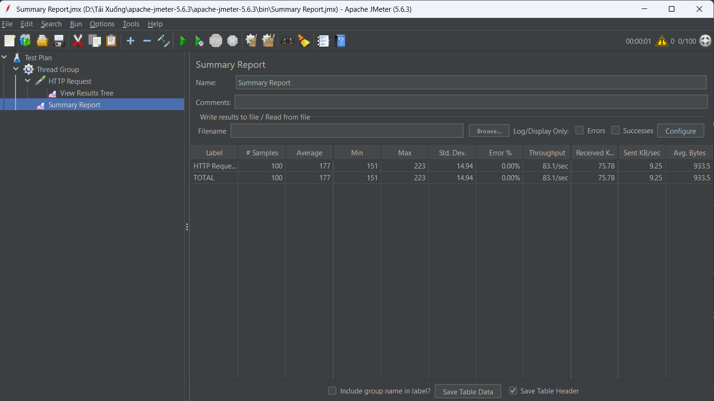

# Báo cáo Lab 8: Kiểm thử tải (Load Testing) với Apache JMeter

**Họ và tên:** Lê Quang Thắng  

**Mã sinh viên:** 23010236

---

## 1. Mục tiêu kiểm thử
Sử dụng công cụ Apache JMeter để giả lập lượng truy cập đồng thời vào một trang web, qua đó đánh giá hiệu năng, thời gian phản hồi và khả năng chịu tải của máy chủ hệ thống.

## 2. Kịch bản kiểm thử (Test Plan)
Kịch bản được thiết lập để mô phỏng một nhóm người dùng cùng lúc truy cập vào trang chủ của website mục tiêu.

- **Website mục tiêu:** `example.com`
- **Giao thức (Protocol):** `https`
- **Phương thức (Method):** `GET`
- **Đường dẫn (Path):** `/`

**Cấu hình Thread Group (Người dùng ảo):**
- **Number of Threads (users):** 10 (Giả lập 10 người dùng truy cập)
- **Ramp-up period (seconds):** 1 (Tạo ra 10 người dùng này trong vòng 1 giây)
- **Loop Count:** 10 (Mỗi người dùng lặp lại thao tác 10 lần)
- **Tổng số Request dự kiến:** 10 x 10 = 100 requests.

---

## 3. Kết quả thực hiện

### 3.1. Chi tiết các Request (View Results Tree)
Tất cả các request gửi đi đều nhận được phản hồi thành công từ máy chủ (HTTP Status Code: 200 OK).

### 3.2. Bảng thống kê tổng hợp (Summary Report)
Dưới đây là bảng thống kê hiệu năng chi tiết sau khi hệ thống xử lý hoàn tất 100 requests:

**Phân tích các chỉ số chính (Dựa trên kết quả đo):**
- **Samples (Tổng số request):** 100
- **Error % (Tỷ lệ lỗi):** 0.00% (Máy chủ xử lý thành công 100% yêu cầu, không có request nào bị rớt).
- **Average (Thời gian phản hồi trung bình):** 177 ms (Tốc độ phản hồi của máy chủ rất nhanh và ổn định).
- **Min / Max (Thời gian phản hồi nhỏ nhất/lớn nhất):** 151 ms / 223 ms.
- **Throughput (Thông lượng):** 83.1 requests/second (Số lượng yêu cầu mà máy chủ xử lý được trong một giây).

---

## 4. Kết luận
Kịch bản kiểm thử chạy thành công đúng như dự kiến. Trang web `example.com` hoạt động ổn định và đáp ứng tốt với lượng tải mô phỏng (100 requests). Tốc độ phản hồi nhanh (trung bình 177ms) và không ghi nhận tình trạng quá tải hay lỗi kết nối (Error 0%) trong suốt quá trình test.
